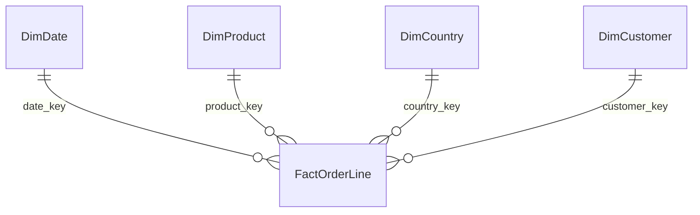

# Retail Sales and Customer Analytics

[](https://github.com/VictorSuicava/retail-sales-customer-analytics/actions/workflows/tests.yml)

A portfolio project using Python, SQL and Power BI to analyse merchandise sales, recorded credits and observed customer repeat purchasing.

**Business question:** Where are sales concentrated, how much do recorded credits reduce sales, and which identified buyers purchase again?

**Intended user:** A commercial analyst reviewing product performance and customer purchasing patterns.

## Status

- Download, normalization, SQLite warehouse and ten CSV exports: implemented and run on the full source.
- Ten business regression tests cover invoice grain, credits, unknown buyers, product key aliases and cohort observation limits.
- Source-to-fact money reconciliation and dimension integrity checks: passed.
- Four-page Power BI source project: imported in Desktop. Native DAX results passed 19,318 comparisons against independent SQL aggregates across 12 months, 38 countries, 3,803 products and 78 observed cohort cells.
- Four pages reviewed in Desktop, including country filtering and table scrolling. The local `powerbi/RetailPortfolio.pbix` contains the imported data and is ready to open.
- The native [four-page PDF](output/pdf/RetailPortfolio.pdf) and [dashboard gallery](docs/dashboard_gallery.md) have been exported and visually reviewed.
- SQL-derived static previews: generated separately from Power BI. They are analytical previews, not Desktop screenshots.

## Results at a glance

The reporting window covers **1 December 2010 to 30 November 2011**, twelve complete months. The partial December 2011 period is excluded.

| Metric | Result |
|---|---:|
| Source observations | 541,909 |
| Merchandise lines in the reporting window | 511,051 |
| Purchase orders | 18,957 |
| Gross merchandise sales | £9,655,544.63 |
| Recorded credit value | £304,597.42 |
| Net merchandise sales | £9,350,947.21 |
| Identified buyers | 4,293 |
| Identified buyers with at least two purchase orders | 2,742 (63.9%) |


These images are rendered from Power BI's native PDF export. Full tables remain scrollable in Desktop; the PDF shows their visible rows. The [SQL sales preview](docs/images/sales-preview.png) and [SQL cohort preview](docs/images/cohort-preview.png) are separate analytical views.

See the [findings](docs/findings.md), [metric definitions](docs/metrics.md), [quality report](docs/quality_report.json) and [native DAX validation](docs/native_validation.json).

## Open the dashboard

[Download the Power BI report (.pbix)](https://github.com/VictorSuicava/retail-sales-customer-analytics/releases/download/v0.1.0/RetailPortfolio.pbix) or browse the [four-page PDF](output/pdf/RetailPortfolio.pdf). The PBIX includes the imported data and opens without rerunning the pipeline. Its refresh parameter points to the author's data folder; rebuild the pipeline and model after cloning to refresh from your own paths.

The PBIX is distributed as a release asset. Git tracks the text-based report definitions, analysis code, PDF and validation evidence.

## Reproduce the analysis

Python 3.10 or later is required.

```powershell
python -m pip install -r requirements.txt
python scripts/pipeline.py
python -m unittest discover -s tests -v
python scripts/build_powerbi.py
```

The first pipeline run downloads the source archive. Subsequent runs reuse the snapshot. Use `python scripts/pipeline.py --refresh` to deliberately replace it.

The builder creates the local semantic model and preserves existing report definitions. Open `powerbi/Retail.pbip` in Power BI Desktop and refresh to import the CSVs. See [Desktop validation](docs/powerbi_setup.md). The machine-specific model file, downloaded data and database are excluded from Git. Rebuild them after cloning.

`--overwrite` on the report builder deliberately replaces model and report edits. A Desktop-authored TMDL model is preserved by refusing to overwrite it.

To regenerate the optional SQL preview images:

```powershell
python -m pip install -r requirements-preview.txt
python scripts/preview.py
```

## Dashboard pages

| Page | Scope |
|---|---|
| Sales overview | Gross sales, credits, net sales, order value and customer ID coverage. Country filter applies. |
| Products and credits | Product ranking and monthly credits. Country filter applies. Large tables can be scrolled. |
| Customer repeat purchasing | Identified buyers and order frequency over the fixed reporting window. |
| Monthly repurchase cohorts | Monthly purchasing after the first observed purchase. Unobserved future ages are absent. |

The customer snapshot and cohort tables are separate fixed-window analytical outputs. They have no relationship to the country or date dimensions and are labelled accordingly.

## Model and SQL

The fact grain is **one source invoice line**. Orders count distinct sale invoices, not lines. Credit invoices do not count as purchase orders.



SQL views provide monthly, product, country, customer and cohort analyses. They use joins, conditional aggregation, window functions and invoice-level intermediate tables. See [schema](sql/schema.sql) and [analytical views](sql/analytics.sql).

## Source and interpretation

Source: Chen, D. (2015). [Online Retail](https://archive.ics.uci.edu/dataset/352/online+retail). UCI Machine Learning Repository. [DOI: 10.24432/C5BW33](https://doi.org/10.24432/C5BW33). Dataset licence: CC BY 4.0. This project transforms the source into a merchandise-only ledger and analytical aggregates.

This is a historical UK retailer dataset, with many wholesale customers. The results describe this dataset, not the current retail market.

- Merchandise is defined by a five-digit stock code with optional letter suffix. Fees, postage and other non-product codes are classified separately.
- Stock codes are normalized to uppercase so case aliases share one product key in Power BI's case-insensitive model. Invoice lines and monetary values are preserved.
- Only positive-price sale lines and negative-quantity credit lines are included. Other adjustments remain in the raw warehouse and quality counts.
- Missing customer IDs contribute to sales totals but are excluded from customer and cohort analyses. Identified buyers cover 85.4% of gross sales.
- Exact duplicate observations are flagged and retained because the source has no unique invoice-line ID. Removing them is an alternative analytical policy, not an established correction. The quality report states the retained count.
- Credit value is measured when recorded. Credits cannot be reliably linked to an original order. The credit-to-sales ratio is not a product return rate.
- The first observed purchase may not be the customer's first-ever purchase. Repeat purchasing is not contractual retention or churn.
- There are no costs, margins, marketing spend or experimental assignments. Profit, campaign ROI and causal effects are outside scope.

## Next development

Investigate duplicate-policy sensitivity and compare customer cohorts over equal observation horizons.
