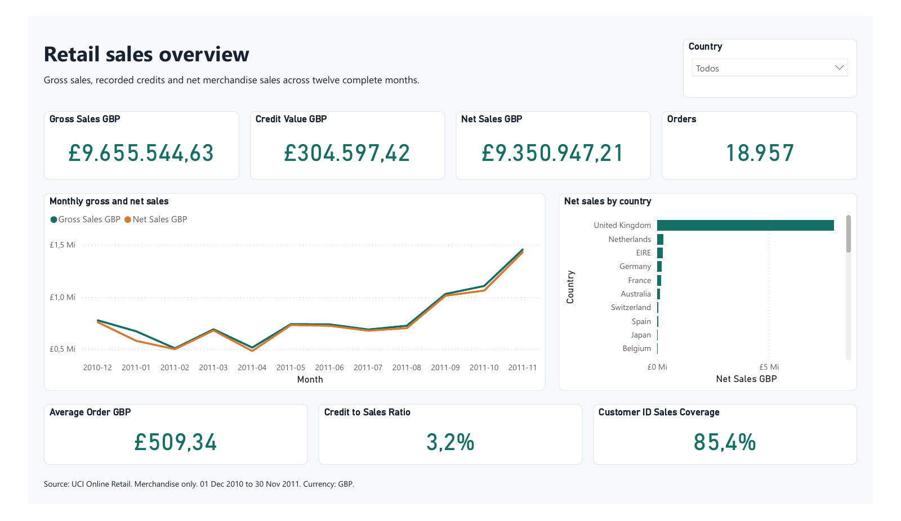
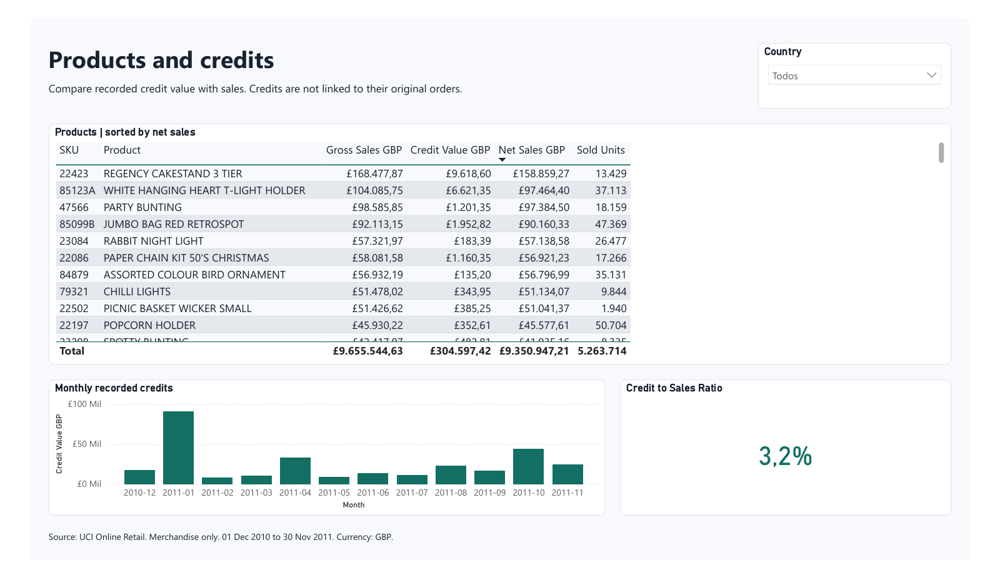
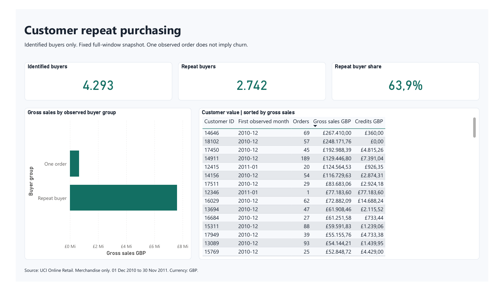
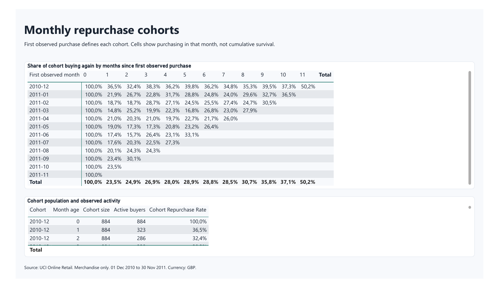

# Power BI dashboard gallery

These four pages were exported directly from Power BI Desktop and rendered from the [native PDF](../output/pdf/RetailPortfolio.pdf). Tables show the visible portion of their scrollable data. Labels are authored in English; native filter text and number separators reflect the Desktop locale.

## Sales overview

Country filtering was verified with United Kingdom: net sales £7,902,009.63 and 17,157 purchase orders. The delivered report starts with all countries selected.

## Products and credits

Products are ranked by net merchandise sales. Credits are reported in their recording month, without assuming a link to the original order.

## Customer repeat purchasing

The fixed-window identified-buyer snapshot contains 4,293 buyers and 2,742 repeat buyers (63.9%). Unknown IDs remain in sales totals and are excluded here.

## Monthly repurchase cohorts

The 2010-12 cohort has 884 buyers; 323 buy at month age 1 (36.5%). Unobserved future ages and row totals are blank. See the [metric definitions](metrics.md) for the interpretation of column totals.
